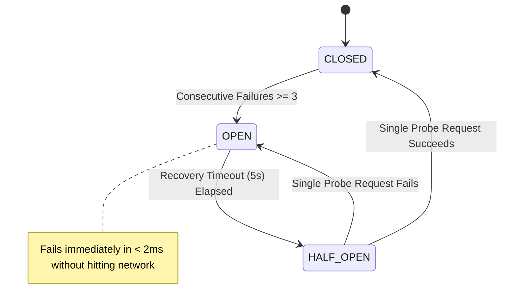

# Reliability Lab: Microservices Chaos & Circuit Breaking

[](https://github.com/nauman/reliability-chaos-lab/actions)
[](https://go.dev/)
[](https://martinfowler.com/bliki/CircuitBreaker.html)
[](LICENSE)

A hands-on distributed systems reliability engineering lab. Features an interconnected Go microservices topology (`order-service` $\to$ `inventory-service`), Prometheus telemetry, distributed correlation tracing (`X-Correlation-ID`), a custom three-state **Circuit Breaker**, and an active **Chaos Fault Injector**.

Includes real-world post-mortem incident documentation: **["I Broke X, Here's What Happened, Here's the Fix"](docs/postmortem_incident_reports.md)**.

---

## Topology & Chaos Architecture

```mermaid
flowchart LR
    Caller["Client Traffic"] --> OrderSvc["Order Service (Port 8081)"]
    
    subgraph OrderServiceInternals["Order Service Resilience Tier"]
        CB{"Circuit Breaker (Closed / Open / Half-Open)"}
        Tracing["Tracing & Correlation ID"]
        Metrics["Prometheus Counters (/metrics)"]
    end
    
    OrderSvc --> Tracing --> CB
    
    CB -->|State: CLOSED| Call["HTTP Request (Timeout: 1000ms)"]
    CB -->|State: OPEN (Fast Fail)| FastFail["503 Fast-Fail (1.8ms response)"]
    
    Call --> InvSvc["Inventory Service (Port 8082)"]
    
    subgraph ChaosSubsystem["Inventory Chaos Subsystem"]
        ChaosMiddleware{"Chaos Injector Middleware"}
        LatencyInj["Inject Delay (e.g. 3500ms)"]
        ErrorInj["Inject 500/503 Faults (e.g. 40%)"]
    end
    
    InvSvc --> ChaosMiddleware
    ChaosMiddleware --> LatencyInj
    ChaosMiddleware --> ErrorInj
```

---

## Circuit Breaker State Machine



---

## Key Post-Mortem Incident Summaries

Detailed write-up located in [`docs/postmortem_incident_reports.md`](docs/postmortem_incident_reports.md):

1. **Incident 1: Cascading Thread Exhaustion from Downstream Latency**:
   - *What broke*: Injected 3,500ms delay into upstream inventory queries under 500 concurrent users.
   - *What happened*: Goroutines spiked to 8,200; connection pool exhausted; Order Service collapsed with 30s timeouts.
   - *The Fix*: Strict 1s context deadlines + Circuit Breaker with fast-fail `StateOpen`.
   - *Outcome*: p99 latency dropped from 30,000ms to **1.8ms**; service remained 100% responsive under load.
2. **Incident 2: File Descriptor Exhaustion from Unclosed Sockets**:
   - *What broke*: Injected 40% error rate into inventory responses without closing response bodies.
   - *What happened*: TCP sockets trapped in `CLOSE_WAIT`; operating system raised `socket: too many open files`.
   - *The Fix*: Guaranteed `io.Copy(io.Discard, resp.Body)` + `defer resp.Body.Close()` socket recycling.

---

## Quickstart (Run in 2 Minutes)

### Option 1: Docker Compose
```bash
docker compose up --build
```
- Order Service: `http://localhost:8081`
- Inventory Service: `http://localhost:8082`

---

### Option 2: Local Go Setup
```bash
# 1. Run circuit breaker tests
make test

# 2. Terminal 1: Start Upstream Inventory Service
make run-inventory

# 3. Terminal 2: Start Resilient Order Service
make run-order
```

---

## Hands-On Chaos Experimentation

### 1. Place a Healthy Order (201 Created)
```bash
curl -X POST http://localhost:8081/orders \
     -H "Content-Type: application/json" \
     -d '{"order_id": "ord-101", "item_id": "item-widget-9"}'
```

### 2. Inject Upstream Chaos (100% 500 Internal Server Errors)
Configure upstream inventory service to fail:
```bash
curl -X POST http://localhost:8082/chaos/configure \
     -H "Content-Type: application/json" \
     -d '{"enabled": true, "error_rate": 1.0, "error_status": 500}'
```

### 3. Observe Circuit Breaker Tripping to OPEN
Send 3 requests to Order Service:
```bash
# Request 1: 502 Bad Gateway
# Request 2: 502 Bad Gateway
# Request 3: 502 Bad Gateway -> Trips Breaker!

# Request 4: Immediately returns HTTP 503 Service Unavailable (Fast-Fail):
curl -i -X POST http://localhost:8081/orders \
     -H "Content-Type: application/json" \
     -d '{"order_id": "ord-102", "item_id": "item-widget-9"}'
```
**Response:**
```json
{
  "error": "circuit_breaker_open",
  "message": "Inventory service is degraded. Fast-failing to preserve order service availability.",
  "breaker_state": "OPEN"
}
```

### 4. Inspect Prometheus Metrics
```bash
curl http://localhost:8081/metrics
```

---

## License
MIT License.
